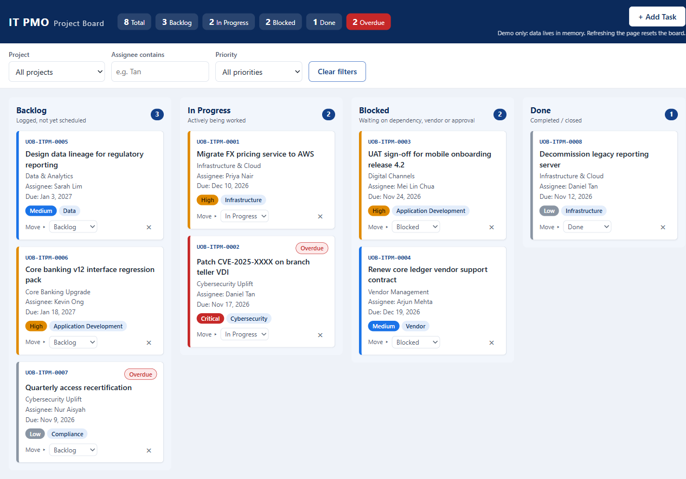
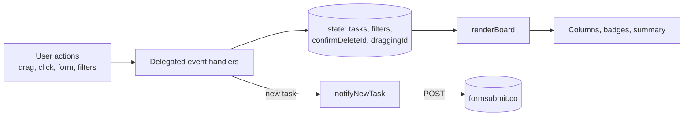

# IT PMO Kanban

A single-file demo Kanban board for a fictitious bank's internal IT PMO. Vanilla HTML, CSS and JavaScript, with no build step and no dependencies.


[](https://github.com/alfredang/kanban12/actions/workflows/ci.yml)

## Live demo

**https://alfredang.github.io/kanban12/**

> All data is fictitious sample data. The board lives in memory only, so a refresh resets it to the seed data.



## Features

- Four columns: Backlog, In Progress, Blocked, Done, each with a count badge and a summary strip
- Drag and drop between columns, plus a per-card "Move" select for keyboard users
- Filters on the board
- Overdue detection (seed due dates are computed relative to today)
- Add Task dialog with inline, per-field validation
- Inline "Delete? Yes/No" confirm (no `alert()` or `confirm()`)
- Optimistic add: the card appears immediately, then an email notification is sent through FormSubmit; on failure a warning toast shows and the card stays
- Responsive: 4-column grid that collapses to one column below 768px

## Architecture



Everything is in [index.html](index.html): markup, a `<style>` block and a `<script>` block.

- **Single state object.** All UI is derived from `state`.
- **One render path.** Mutations update state and then call `renderBoard()`, the only place card DOM is built. User-supplied values go through `escapeHtml()`.
- **Event delegation.** Handlers are bound once on the board, so re-rendering needs no rebinding.
- **Dates** are compared as local `YYYY-MM-DD` strings to avoid UTC off-by-one errors.
- **Script sections:** config, constants, state, date helpers, utilities, seed data, filtering, rendering, actions, toasts, FormSubmit, form validation and submit, drag and drop, init.

```
.
├── index.html                # the whole app
├── CLAUDE.md                 # project guidance
├── docs/screenshot.png       # live-site screenshot used in this README
├── .claude/commands/publish.md
└── .github/workflows/ci.yml  # checks + GitHub Pages deploy
```

## Run locally

```bash
git clone https://github.com/alfredang/kanban12.git
cd kanban12
start index.html        # Windows (macOS: open, Linux: xdg-open)
```

It works straight from `file://`. No install or build is needed. Optionally serve it with `python -m http.server`.

## Configuration

The config block at the top of the script holds `FORMSUBMIT_ENDPOINT`, `ID_PREFIX`, `SUBJECT_PREFIX` and `TOAST_MS`.

`FORMSUBMIT_ENDPOINT` ships with the placeholder `YOUR_EMAIL@example.com`, so nothing is delivered until you set it. FormSubmit needs a one-time activation: the first submission sends an activation email, and notifications are delivered only after its link is clicked. Prefer the random alias FormSubmit gives you in that email over a raw address, because anything in this file is public on GitHub Pages.

## CI/CD

[`ci.yml`](.github/workflows/ci.yml) runs on every push and pull request to `main`:

1. **check:** a gitleaks secret scan, project constraint checks (no external scripts, fonts or CDNs; no `localStorage`/`sessionStorage`/`indexedDB`/cookies; no `alert()`/`confirm()`; no `!important`; `formsubmit.co` is the only allowed host), and HTML validation.
2. **deploy:** on pushes to `main`, publishes `index.html` to GitHub Pages.

## Security and privacy

- No persistence of any kind: no cookies or web storage.
- The only network call is the FormSubmit POST when a task is added. It sends only that task's fields (ID, title, description, project, category, assignee, priority, due date, status, timestamp).
- No external resources, fonts, images or trackers.
- No real bank logo or trademark is used.
